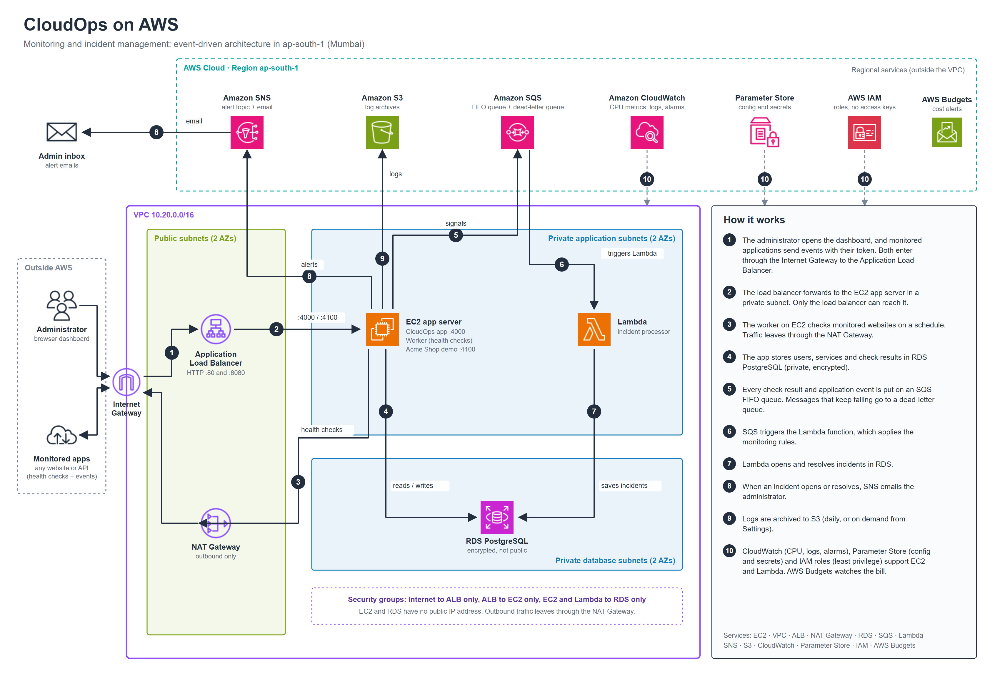

# CloudOps

Monitoring and incident management for websites and APIs, built on AWS.

CloudOps checks your services on a schedule, learns what is happening inside connected applications (requests, errors, failed sign-ins), opens an **incident** when a rule trips, and emails the administrator. A web dashboard shows service health, every endpoint of a connected app, metrics, logs and incidents.



Editable vector version: [docs/architecture.svg](docs/architecture.svg).

## What it does

- **Health checks:** real HTTP(S) requests on a schedule (interval, timeout, expected status). Works for any public website or API, with nothing to install on the target.
- **Connected applications:** an application adds a few lines of code and a per-service **ingestion token**. CloudOps then sees every request (method, route, status, duration), failed sign-ins and custom events, and builds a per-endpoint view automatically. The in-app **Connect your app** guide gives copy-paste code for Node.js, Python and plain HTTP.
- **Incidents:** availability, response latency, statistical latency anomalies, API error rate **per endpoint**, repeated failed sign-ins per account, and sustained CPU. Incidents deduplicate, carry evidence and a timeline, and resolve automatically on recovery.
- **Alerts:** an email through Amazon SNS when an incident opens or resolves.
- **Dashboard:** overview, services, a full page per service (endpoints with p95 latency, charts, incidents, logs), metrics, logs, monitoring rules and settings.
- **Event pipeline on AWS:** events go to an SQS FIFO queue, a Lambda function applies the rules and writes incidents to RDS PostgreSQL, SNS sends the alert, S3 keeps log archives, CloudWatch supplies CPU.
- **Security:** hashed passwords, secure sessions, CSRF protection, origin checks, rate limits, SSRF protection for monitored URLs, private subnets, least-privilege IAM roles and no static AWS keys.

## Run it locally

Requires **Node.js 24**.

```sh
npm ci
npm run dev          # dashboard on http://127.0.0.1:5173, API and worker included
```

The first visit asks you to create the administrator account. Locally the data lives in `data/cloudops.sqlite`; AWS deployments use PostgreSQL.

To try it with a realistic application, start the demo shop in a second terminal:

```sh
npm run demo-shop    # http://127.0.0.1:4100  (store)  and  /control  (presenter controls)
```

See [docs/LOCAL-TESTING.md](docs/LOCAL-TESTING.md) for a walkthrough.

```sh
npm test             # automated tests
npm run build        # production build of the dashboard
npm start            # serve the built dashboard and API on port 4000
npm run worker       # the worker process (checks, delivery), when not using npm run dev
```

## Connect your own application

1. In the dashboard, add a service and tick **Connect my application** (or open a service and click **Connect your app**).
2. Copy the ingestion token into your server's environment as `CLOUDOPS_INGESTION_TOKEN`.
3. Add the generated code to your app. Every request, error and failed sign-in is reported, and the Endpoints tab fills in by itself.

Any language can report an event with one HTTP request:

```sh
curl -X POST https://YOUR-CLOUDOPS/api/events \
  -H "Authorization: Bearer $CLOUDOPS_INGESTION_TOKEN" -H "Content-Type: application/json" \
  -d '{"id":"evt-0001-unique","type":"request","method":"POST","route":"/api/orders","statusCode":502,"duration":120,"message":"POST /api/orders"}'
```

Event types: `request`, `auth_failure` (needs `subject`), `cpu` (needs `value`), `log`. Use the token only on a server, never in browser code.

## Deploy on AWS

The whole environment is one CloudFormation template: VPC, subnets, NAT, ALB, EC2, RDS, SQS, Lambda, SNS, S3, CloudWatch, Parameter Store, IAM and a budget. Follow [docs/DEPLOYMENT.md](docs/DEPLOYMENT.md). The same document covers updating the app and tearing everything down.

## Project layout

```text
src/            React dashboard (shadcn/ui and Tailwind)
server/         Express API, monitoring worker, rules and incident logic, Lambda handler
scripts/        development launcher, migrations, Lambda packaging, admin password reset
deploy/         CloudFormation template and the demo shop's service file
examples/       Acme Shop: a demo application that is monitored by CloudOps
docs/           architecture diagram, deployment and local testing guides
certs/          Amazon RDS CA bundle (used for verified TLS to PostgreSQL)
```

## Reset the administrator password

Locally: set `RESET_EMAIL` and `RESET_PASSWORD` in an untracked `.env`, run `npm run admin:reset`, then remove those values. All sessions are revoked.

On AWS: create the temporary Parameter Store values `/cloudops/prod/RESET_EMAIL` and `/cloudops/prod/RESET_PASSWORD`, run `node scripts/reset-password.mjs` on the server, and delete the parameters afterwards.

## Operating notes

- A single-workspace operations tool for a controlled deployment. There is no multi-tenant isolation, SSO/MFA, on-call rotation or tracing.
- Detection uses configurable rules and a rolling statistical baseline for latency. It is not a trained model.
- Alerts are delivered at least once; a crash between publishing and recording can send a duplicate. The incident ID is included for correlation.
- Monitored URLs must be public: private, loopback and metadata addresses are blocked, and redirects are not followed.
- The dashboard returns the latest 500 incidents and logs and 24 hours of metrics. Validate behaviour before scaling to many services.
- Health checks run from one location (the app server's NAT address), so a site that blocks datacenter addresses can look down.
- Without a domain the demo runs over HTTP. For production, put an ACM certificate on the load balancer and unset `ALLOW_INSECURE_HTTP`.
